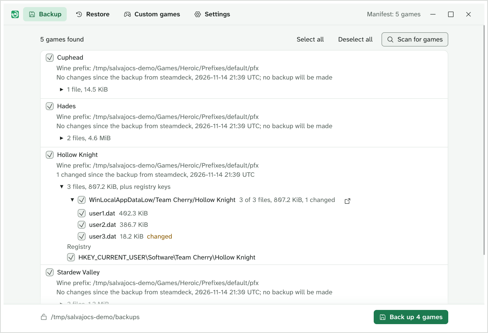
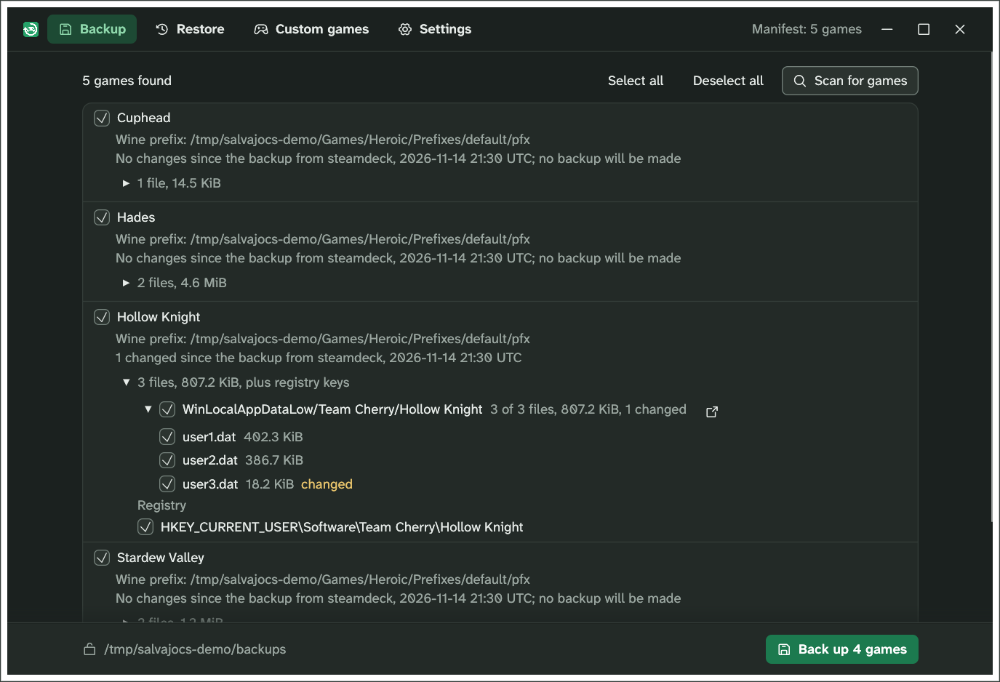
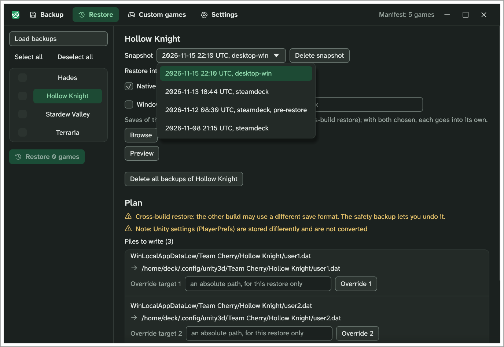
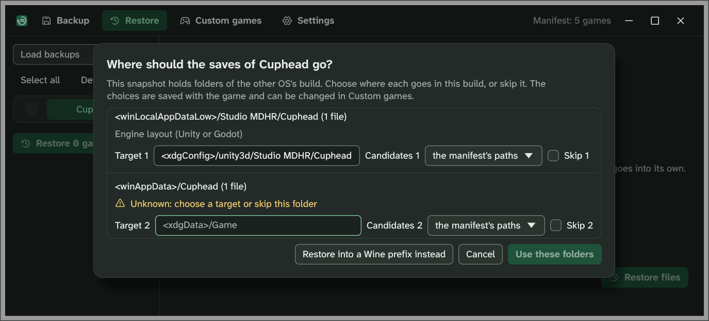
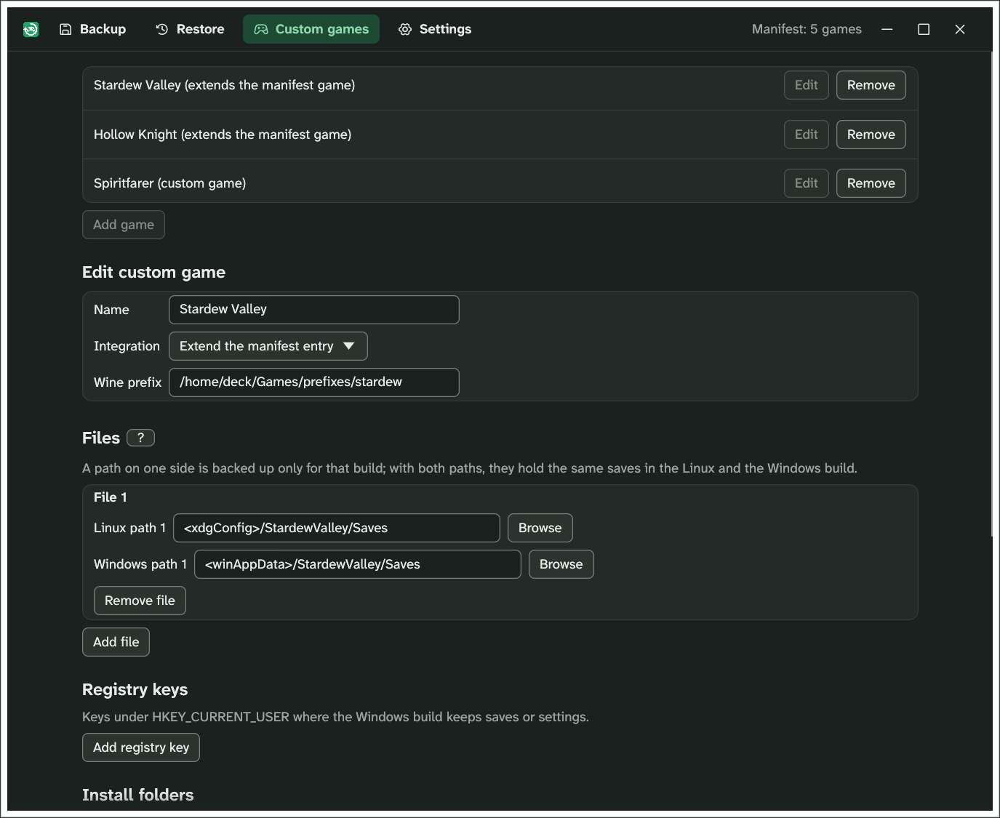
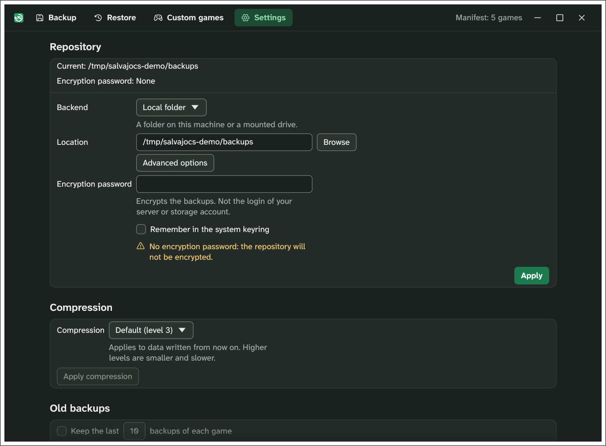
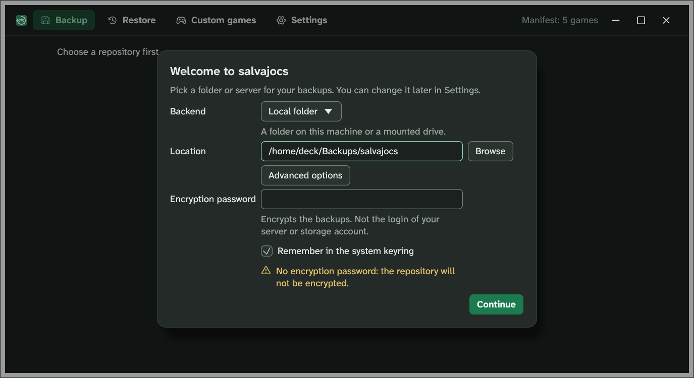
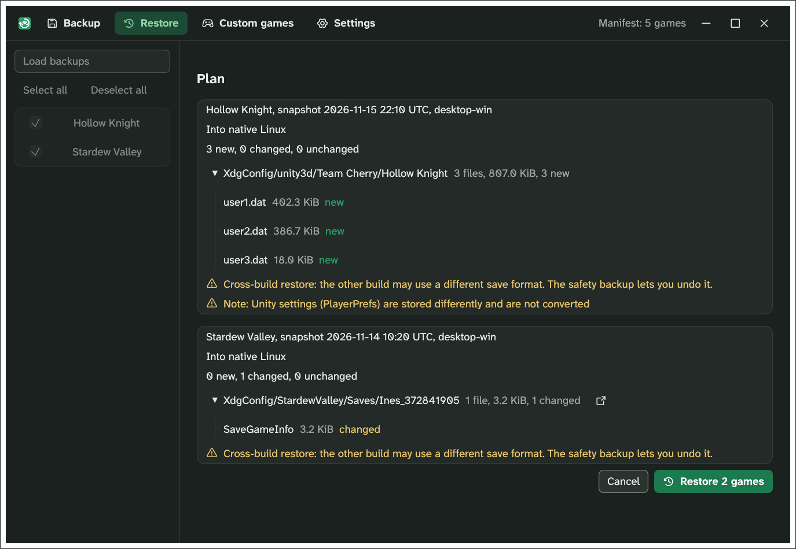

#  salvajocs

Back up and restore game saves in a restic-format repository, from a desktop app for Linux and
Windows. A save backed up from a Wine/Proton prefix on Linux restores on native Windows, and the
other way round.

[](https://crates.io/crates/salvajocs)
[](https://docs.rs/salvajocs-core)
[](https://github.com/jmigual/salvajocs/actions/workflows/ci.yml)
[](LICENSE)
[](Cargo.toml)
[](#install)

> **Status: early (0.x).** The app works and is tested on Linux and Windows. Releases are on
> [crates.io](https://crates.io/crates/salvajocs) and
> [GitHub Releases](https://github.com/jmigual/salvajocs/releases). Behavior and the library API
> can change between minor versions.

<p align="center">
  <picture>
    <source media="(prefers-color-scheme: dark)" srcset="https://raw.githubusercontent.com/jmigual/salvajocs/main/docs/images/backup.png">
    <source media="(prefers-color-scheme: light)" srcset="https://raw.githubusercontent.com/jmigual/salvajocs/main/docs/images/hero-light.png">
    
  </picture>
</p>

## Contents

- [Features](#features)
- [Screenshots](#screenshots)
- [How it works](#how-it-works)
- [Install](#install)
- [Quick start](#quick-start)
- [Restore a save from Linux on Windows](#restore-a-save-from-linux-on-windows)
- [Comparison with other tools](#comparison-with-other-tools)
- [Limitations](#limitations)
- [Documentation](#documentation)
- [Development](#development)
- [License](#license)
- [Credits](#credits)

## Features

| Area | What it does |
| --- | --- |
| Game list | Uses the [ludusavi manifest](https://github.com/mtkennerly/ludusavi-manifest), about 52,000 games. It is downloaded at start (with ETag revalidation) and cached. |
| Scan | Finds saves in the native folders, in Steam Proton prefixes (by Steam id), in the Wine prefixes of Heroic, Lutris and Bottles on Linux, in Wine prefixes you configure and for custom games. |
| Registry | Backs up and restores registry keys: the live registry on Windows, `user.reg` inside a Wine/Proton prefix. |
| Storage | One repository for every machine: a local folder, a REST server, an rclone remote or an OpenDAL service (S3, WebDAV, Google Drive and more), through the embedded rustic library. The Restore tab lists the backups of all machines. |
| Readable data | The repository is plain restic format. You can list and copy files out of it with the restic command line. |
| Compression | zstd, chosen when the repository is created: off, a preset (levels 1, 3, 9, 19) or a custom level 1 to 22 or -7 to -1. Changeable in Settings. |
| Encryption password | Optional. Kept in the OS keyring (Secret Service on Linux, Credential Manager on Windows) or asked once per session. |
| Backup | One snapshot per game, deduplicated by the repository. A game that did not change adds no snapshot. |
| Restore | Preview of every file and registry key first, per-file target override, a safety backup of what would be overwritten, undo. |
| Cross-OS | Files are stored under named folders, not absolute paths, and the Windows user name is never stored. A Proton save restores on Windows and the other way round. Games with a native Linux build and a Windows build map through saved pairs, engine rules (Unity, Godot), the manifest, or a dialog. Choices are remembered. |
| Custom games | Add a game, extend or override its manifest entry, set its Wine prefix, edit pairs and skipped folders. |

## Screenshots

| Backup: scan and pick games | Restore: preview before anything is written |
| --- | --- |
|  |  |
| **Mapping dialog: where each folder goes on the other build** | **Custom games: a game's paths, pairs and skipped folders** |
|  |  |
| **Settings: repository, compression and roots** | **First run: repository and encryption password** |
|  |  |
| **Restore several games: each file labelled new or changed** | |
|  | |

## How it works

1. **Scan.** The manifest says where each game keeps its saves, with placeholders such as
   `<winDocuments>` or `<xdgData>`. salvajocs resolves them on this machine, including inside
   Wine/Proton prefixes.
2. **Backup.** Each game's files are copied under a named folder (`WinDocuments`, `XdgConfig` and
   so on) and stored as one snapshot, together with its registry keys.
3. **Restore.** The named folders are resolved on the machine you restore to, and the Windows user
   name is swapped for the target's user.

```
 Linux, Proton prefix      backup   Snapshot in the repository   restore   Windows
 --------------------      ------   --------------------------   -------   -------
 steamuser/Documents/      -->      files/WinDocuments/          -->       C:\Users\<you>\Documents\
   My Games/Foo/save1.dat           My Games/Foo/save1.dat               My Games\Foo\save1.dat

 user.reg                  -->      registry.json                -->       HKEY_CURRENT_USER
   [Software\Foo]                    Software\Foo                          Software\Foo

 The snapshot also holds salvajocs.json: where each folder came from.
```

The snapshot is tagged `salvajocs` and `game:<slug>`. Before a restore writes anything, it backs up
the files and keys it would replace into a snapshot tagged `pre-restore`. If that backup fails,
nothing is restored.

## Install

- **AppImage (Linux):** download `salvajocs-<version>-x86_64.AppImage` from the
  [latest release](https://github.com/jmigual/salvajocs/releases/latest), run `chmod +x` on it and
  start it. Gear Lever or AppImageUpdate update it in place.
- **Windows installer:** download `salvajocs-<version>-x86_64-setup.exe` from the same page and
  run it. It installs per user, without admin rights, and the app offers updates.
- **Windows zip:** `salvajocs-x86_64-pc-windows-msvc-v<version>.zip` from the same page; extract it
  and run `salvajocs.exe`.
- **mise:** `mise use -g github:jmigual/salvajocs`, or `mise use -g cargo:salvajocs` for crates.io
  ([details](docs/guide/installation.md#mise)).
- **cargo-binstall:** `cargo binstall salvajocs`.
- **cargo:** `cargo install --locked salvajocs` (Rust 1.95 or newer).
- **Latest from `main`:** `cargo install --locked --git https://github.com/jmigual/salvajocs salvajocs`.

Requirements and details are in the [installation guide](docs/guide/installation.md). macOS is not
supported.

## Quick start

1. Start `salvajocs`. On first run, choose where backups go (a folder is the default) and an optional
   encryption password. salvajocs asks, with a compression level, before it creates a new repository.
2. Open the **Backup** tab and click **Scan for games**. Tick the games and click
   **Back up N games**.
3. On the machine you want to restore to, start salvajocs and connect to the same repository.
4. Open the **Restore** tab, click **Load backups**, choose a game and a snapshot, pick the
   target, click **Preview**, and then **Restore files**.

On Linux, add your Steam libraries and Wine prefixes in **Settings** if salvajocs does not find
them. More in the [user guide](docs/guide/README.md).

## Restore a save from Linux on Windows

You play a game with Proton on Linux and want its save on your Windows PC.

1. **Share the repository.** Pick a backend that both machines can reach and that Windows builds
   have (see [Limitations](#limitations)), such as a REST server or an rclone remote.
2. **Back up on Linux.** Scan, tick the game, **Back up 1 game**. The save files come from the
   Proton prefix, and the game's registry keys come from the prefix's `user.reg`.
3. **Connect on Windows.** Start salvajocs, choose the same backend and location, and type the same
   encryption password.
4. **Restore on Windows.** **Load backups**, choose the game and the snapshot from the Linux
   machine, **Preview**. The plan lists each file in your Windows folders and the registry keys. Click **Restore files**.

The other direction works too. Restore on Linux into **Windows build in a Wine/Proton prefix**,
after you started the game once with Proton so that the prefix exists, and with every Wine and
Proton program closed. Games with a separate native Linux build need the mapping described in
[Cross-OS restore](docs/guide/cross-os-restore.md).

## Comparison with other tools

| | salvajocs | [ludusavi](https://github.com/mtkennerly/ludusavi) | restic / rustic |
| --- | --- | --- | --- |
| Purpose | Game saves | Game saves | Any files |
| Game list | ludusavi manifest | ludusavi manifest | None; you give the paths |
| Storage | restic-format repository, local or remote | Not a restic repository | restic-format repository |
| Moving saves between operating systems | Automatic for Wine/Proton and Windows; rules and a dialog for native Linux builds | Redirects you set up, and a [guide to transferring between operating systems](https://github.com/mtkennerly/ludusavi/blob/master/docs/help/transfer-between-operating-systems.md) | Not aware of games |
| Launcher discovery on Linux | Steam/Proton, Heroic, Lutris, Bottles, prefixes you add, custom games | Steam, Heroic and Lutris among others, and roots you add | Not applicable |
| Releases | Early (0.x) | Yes | Yes |
| Command line | No | [Yes](https://github.com/mtkennerly/ludusavi/blob/master/docs/help/command-line.md) | Yes |
| Retention of old backups | No | [Yes](https://github.com/mtkennerly/ludusavi/blob/master/docs/help/backup-retention.md) | Yes (`forget`, `prune`) |

Use ludusavi if you want a mature tool with releases and wider launcher support. Use restic or
rustic for general backups. salvajocs uses the same repository format as restic, so you can read
its repository with restic. See [Using the repository with restic](docs/guide/restic-interop.md)
for what was tested.

## Limitations

- A graphical app only; there is no command line.
- Linux and Windows only. macOS is not supported.
- Only `HKEY_CURRENT_USER` registry keys are handled. Other hives are skipped.
- Lutris games whose prefix is a relative path are not found. Add the prefix in Settings or on a
  custom game.
- Steam library folders on other drives are not read from Steam's configuration. Add them in
  Settings. Non-Steam shortcuts are not matched.
- A restore that includes registry keys for a Wine prefix is refused while any `wineserver` runs.
- Unity `PlayerPrefs` are detected but not converted between the registry and the Linux file.
  Engine rules exist for Unity and Godot only.
- Snapshots are never deleted: there is no retention and no scheduled or automatic backup.
- The first start needs network access to get the game list. After that, a cached copy is used.
- `opendal:sftp` is not available in Windows builds.
- Undo restores what the restore overwrote. Files or keys it created stay.

## Documentation

The [user guide](docs/guide/README.md) covers the app tab by tab:

- [Installation](docs/guide/installation.md)
- [First run](docs/guide/first-run.md): repository, compression, encryption password and keyring
- [Backup](docs/guide/backup.md)
- [Restore](docs/guide/restore.md): targets, preview, overrides, safety backup, undo
- [Cross-OS restore](docs/guide/cross-os-restore.md): Wine/Proton and Windows, the mapping dialog
- [Custom games](docs/guide/custom-games.md)
- [Settings](docs/guide/settings.md): roots, Steam libraries, Wine prefixes
- [Using the repository with restic](docs/guide/restic-interop.md)
- [Troubleshooting](docs/guide/troubleshooting.md)

## Development

The workspace has two crates: `salvajocs-core` (all logic) and `salvajocs` (the egui app, in
`crates/salvajocs-gui`).

```sh
cargo fmt --check
cargo clippy --workspace --all-targets -- -D warnings
cargo test --workspace
```

Tests that need the network, an OS credential store, timing or a GPU are `#[ignore]`d. CI runs
`cargo test --workspace -- --include-ignored`, and skips the `keyring_` tests on Linux, where the
runner has no Secret Service.

To regenerate the screenshots in `docs/images` (Linux only):

```sh
SALVAJOCS_SCREENSHOTS=1 cargo test -p salvajocs --features screenshots --test appearance -- --ignored
```

`salvajocs-core` is published as a library on [crates.io](https://crates.io/crates/salvajocs-core),
with docs on [docs.rs](https://docs.rs/salvajocs-core), for building other tools on it. Its API is
0.x. See its [README](crates/salvajocs-core/README.md).

Design decisions are in the ADR index, [docs/adrs/README.md](docs/adrs/README.md). Read the index
before opening an ADR. The implementation plan is [docs/plan.md](docs/plan.md).

## License

The code is [MIT](LICENSE); the `salvajocs` crate is `MIT AND OFL-1.1`. The app embeds fonts under
their own licenses, and the installers and release archives ship their texts:

- Atkinson Hyperlegible Next: [SIL Open Font License 1.1](crates/salvajocs-gui/assets/fonts/OFL.txt).
- A subset of Phosphor Icons: [MIT](crates/salvajocs-gui/assets/fonts/Phosphor-LICENSE.txt).
- egui's default fonts, from its `epaint_default_fonts` dependency: Ubuntu Light under the
  [Ubuntu Font Licence 1.0](crates/salvajocs-gui/assets/fonts/Ubuntu-font-LICENSE.txt), Hack
  under [MIT and the Bitstream Vera License](crates/salvajocs-gui/assets/fonts/Hack-LICENSE.txt),
  and egui-icons, a subset of emoji-icon-font, under
  [MIT](crates/salvajocs-gui/assets/fonts/emoji-icon-font-LICENSE.txt).

## Credits

- The [ludusavi manifest](https://github.com/mtkennerly/ludusavi-manifest) by mtkennerly provides
  the games and their save locations.
- [rustic_core](https://github.com/rustic-rs/rustic_core) provides the restic-format repository.
- [egui](https://github.com/emilk/egui) draws the interface.
- [restic](https://restic.net) defined the repository format.
