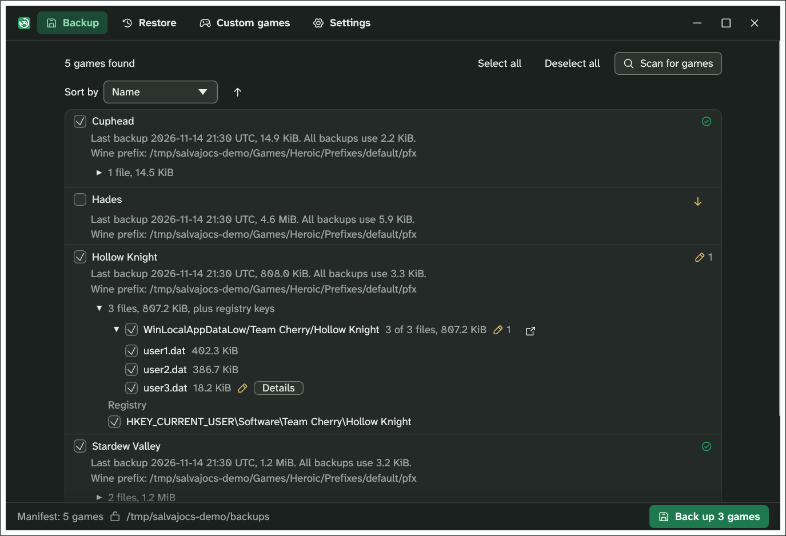
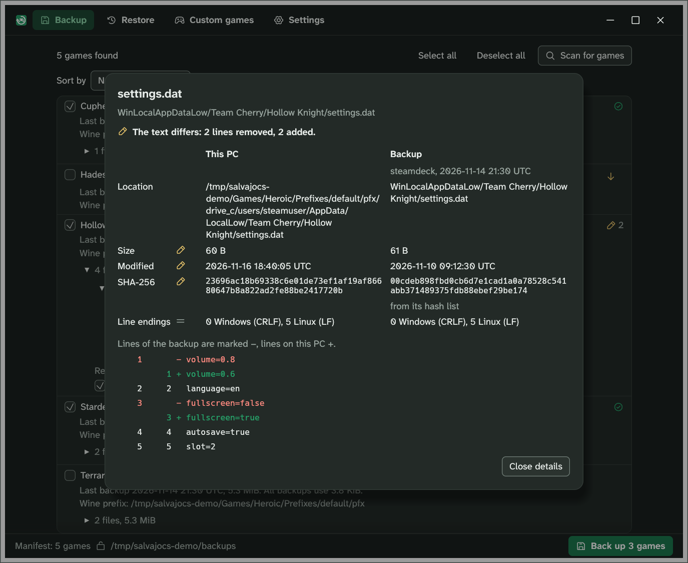

# Backup

The Backup tab scans this machine for games with saves and stores the ones you choose in the
repository, one snapshot per game. This page explains the scan, the choices and the result. Back
to the [guide index](README.md).

salvajocs has two jobs:

- **Back up your games.** Every backup stays in the game's history until the
  [Old backups](settings.md#old-backups) rules remove it, so you can go back to an older version.
- **Sync your PCs.** All the PCs that use the repository share one history per game. Its newest
  backup is "the saves". Each PC knows whether it is up to date with them, ahead of them, behind
  them (a newer backup exists), changed on both sides, or does not know, and Back up acts on
  that. See [Syncing PCs](#syncing-pcs).

## Where the game list comes from

salvajocs uses the [ludusavi manifest](https://github.com/mtkennerly/ludusavi-manifest), a public
list of about 52,000 games (entries that are not aliases, measured in November 2026) and where
each one keeps its saves. salvajocs downloads it when it starts and keeps a copy in the cache
folder. The bar along the bottom of the window shows the number of games loaded.

- The first start needs network access to get any game. Without a cache and without network, only
  your [custom games](custom-games.md) are scanned, and the tab says so.
- The scan and backup buttons wait while the manifest is loading.

## Scan

Click **Scan for games**. The scan checks, for every game in the manifest and every custom game:

- the save folders of this machine (native Windows folders on Windows, the XDG folders on Linux);
- on Linux, the Proton prefix of each Steam game, under every Steam root salvajocs finds
  (`~/.steam/steam`, `~/.local/share/Steam` and the Flatpak Steam folder) and under every Steam
  library you added in [Settings](settings.md#roots);
- on Linux, every Wine prefix you added in Settings, and the `wine_prefix` of each custom game;
- on Linux, the Wine prefixes of Heroic, Lutris and Bottles that are ticked in
  [Settings](settings.md#found-by-salvajocs). A Heroic or Lutris prefix is checked for its own
  game; the others for every game;
- the registry keys of the game under `HKEY_CURRENT_USER`: the live registry on Windows, or
  `user.reg` inside the prefix on Linux. Other registry hives are not backed up.

Inside a Wine prefix, folder names match without regard to upper and lower case, because Windows
games do not care about it.

The scan runs in the background. Checking the whole manifest can take several seconds.

### Scan problems

Problems are listed in yellow above the games and do not stop the scan:

- the Wine prefix has several users and none is `steamuser`;
- the Wine prefix has no user yet (run the game once);
- the folder is not a Wine prefix;
- a folder cannot be read;
- a Heroic, Lutris or Bottles file cannot be read.

A game with unreadable paths shows how many, because its backup may be incomplete.

## Choose and back up

Each game found has a checkbox and a line such as `3 files, 1.2 MiB, plus registry keys`. A
game's checkbox says whether it is backed up at all. New games start selected. **Select all** and
**Deselect all** change every game at once.
A game found in a Wine or Proton prefix shows it as `Wine prefix: <folder>`, one line per prefix
its files or registry keys came from.

### Sort and backup sizes

Once the comparison below has listed the backups, each game shows a line such as
`Last backup 2026-11-19 14:02 UTC, 980.0 KiB. All backups use 3.1 MiB.`:

- The last backup is the newest one from any machine, not counting the safety backups a restore
  makes. Its size is that of its files before compression; it also counts the few small files
  salvajocs adds, so it can read a little larger than the files found here.
- All backups use is the space the game's backups take in the repository, compressed, safety
  backups included. A file two backups share counts once. Data that another game's backups also
  use counts for both games, so the figures of all games can add up to more than the repository
  holds. Data a removed backup left behind until the next cleanup is not counted.
- `…` means the space is still being worked out, and `size unknown` a backup made by a tool that
  does not record its size. A game without a backup says `No backup.`, or how much space its
  safety backups use.

The **Sort by** row above the list orders the games by **Name**, **Last backup**, **Last backup
size**, **Space used** or **Changes**; hover an item to read what it means. The arrow button
next to it reverses the order and says the current one, such as **Largest first**. Picking a key
starts in its natural order: names A to Z, times newest first, sizes largest first, most changes
first. Games without the value, such as one without a backup, stay at the end either way. The
figure the list is sorted by is drawn brighter on each line (for **Changes**, the count in the
game's header). The choice is saved, and the Restore tab keeps its own.

**Changes** counts the files the next backup would add, change or remove compared with the
newest backup, the number each game's header shows. A game without a backup yet counts all its
files, and a game with no changes counts 0. A game whose comparison has not arrived, has failed
or is not backed up stays at the end. The order is built when the comparisons arrive, so
ticking or unticking a file does not move a game; reverse the order, pick another key, scan or
back up to take the ticks into account. The Restore tab has no **Changes**.

Open the line to see the game's files as a tree of folders, each with a checkbox, and its registry
keys under **Registry**:

- Unchecking a folder leaves out every file below it; checking it takes them all back. A folder
  with only some files checked shows a dash.
- A folder that holds only another folder is shown on one line with it, as `Home/.var/app`. The
  checkbox covers the whole line, and the button opens the last folder.
- The line counts only the files that are backed up, and says how many are excluded, as in
  `2 files, 1.1 MiB, 1 excluded`.
- A game with every file and key unchecked gets no snapshot.
- Below Windows folders, names that differ only in upper and lower case are one folder.
- The button at the end of a folder's line, **Show … in the file manager**, opens that folder. A
  folder whose files come from two places, such as two prefixes or install folders, opens the
  first.

### Syncing PCs

Each game has one history in the repository, ordered by time, whichever PC made each backup. The
newest backup is the game's saves.

Back up only stores a game by itself when this PC is the only one that changed the saves.
Otherwise the game is up to date, or it waits for your choice.

| State | What it means | What Back up does |
| --- | --- | --- |
| No backup yet | The repository has no backup of the game. | Backs it up. |
| Up to date | This PC's saves are the newest backup's. | Stores nothing. |
| This PC changed (ahead) | The newest backup is the last synced one, and this PC changed the saves since. | Backs up this PC's saves, which become the newest. |
| Behind | A newer backup than the last synced one exists, usually from another PC, and this PC has not changed the saves since it last synced. | Waits for your choice. Restore the newest backup on the [Restore tab](restore.md), or [back up this PC's saves](#choosing-for-a-game-that-waits). |
| Changed on both | A newer backup than the last synced one exists, and this PC changed the saves too. | Waits for your choice. |
| Last sync unknown | This PC does not know its last synced backup, and its saves differ from the newest backup. | Waits for your choice. |

Each PC remembers, for each game, the **last synced backup**: the backup it last backed up, last
found to hold the same files as the newest backup, or last restored. A restore counts even when
it restores a safety backup (an [undo](restore.md#undo)). A restore in which a file failed leaves
it unchanged. The PC keeps this memory itself, in `sync-base.json` in the config folder; it is
not in the repository, so every PC has its own. After a restore it also keeps a list of this PC's
files, which [the Restore page](restore.md#which-backup-this-pc-is-in-sync-with) explains.

That memory lets salvajocs tell who changed the saves. It compares three things: this PC's saves
now, the newest backup, and the last synced backup. If this PC's saves still match the last
synced backup but the newest backup is another one, only a newer backup changed the saves. If
they do not match, this PC changed them (if the newest backup is also another one, both did).

A behind game is never backed up by itself, on purpose. Storing this PC's older saves would make
them the newest backup, and every other PC would then be told to restore them. Behind does not
need another PC: if you restore an older backup of this same PC, the game reads behind too, and
its text then says "this PC": `Behind: this PC made a newer backup, <date>. Click to compare`.
If you then change the saves, the game reads changed on both, and the text says `Changed on
both: this PC changed the saves since it restored an older backup.`

After you restore the newest backup, the game is up to date, unless this PC keeps files the backup
lacks. The Backup tab then counts those files as new, and the next Back up stores them with the
restored saves (see
[Deleting files the backup does not have](restore.md#deleting-files-the-backup-does-not-have)).
After an [undo](restore.md#undo), the game reads behind unless the saves it brings back are the
newest backup's, and stays behind until this PC's saves change. Then it reads changed on both.

A game that is changed on both, or whose last sync is unknown, needs a decision from you:
salvajocs cannot tell which saves should win, and it will not overwrite either silently. The last
sync is unknown when this PC has no sync record yet, for example after an upgrade. Changing the
repository or its options in Settings does the same for every game, since this PC has no record
for the new repository, and each game that differs then waits for your choice. salvajocs first
guesses that this PC's own last backup of the game is the last synced one. The last sync stays
unknown when this PC has no such backup, or when that backup is the newest one and the saves
changed since.

A game has a sync record from its first Back up or restore with this version of salvajocs, so
the choice for an unknown last sync is needed once per game and repository.

Upgrade salvajocs on all your PCs at the same time. A PC that still runs an older version does
not follow these rules and can make an older save the newest.

#### Choosing for a game that waits

A game that is behind, changed on both or has an unknown last sync shows only its mark, and its
box is unticked: Back up leaves it out. It shows no counts and no file tree in the list. Back up
asks nothing about it.

Click the mark to open the game's compare window. It shows one line on why the game waits and
how this PC's saves differ from the newest backup, and the game's file tree with the same marks
and ticks as the list: a file only on this PC is new, a file only in the newest backup is
removed. The folders that hold a difference are open, with a **Details** button on each changed
file. Ticks you change there are saved as in the list. Then choose:

- **Back up this PC's saves**: the box is ticked, and the next Back up stores the game. This PC's
  saves become the newest backup. The other PC's backup stays in the history as an older version.
  The other PC will then show as behind, so choose this only when this PC's saves are the ones to
  keep.
- **Open in Restore**, at the left: closes the window, changes no choice and opens the game with
  its newest backup in the [Restore tab](restore.md). If the game is already open there, or the
  Restore tab is busy, it only shows the tab. The window does not offer it when a restore would
  write nothing: the only differences are files this PC has and the newest backup does not, the
  backup has no registry keys, and the game's box "Delete files the backup does not have" is
  off. Untick those files to match the backup instead.
- **Don't back up**: the box stays unticked, and Back up leaves the game out. Restore the newest
  backup on the Restore tab instead; a restore first saves this PC's files as a safety backup, so
  they are not lost.

Ticking the box in the list does the same as **Back up this PC's saves**, and unticking it the
same as **Don't back up**. **Deselect all** unticks waiting games too; **Select all** leaves them
as they are. This choice is not saved: it holds for the next Back up only, and a new scan or
another repository unticks the box again.

When Back up backs up at least one game, it also checks each waiting game you left unticked,
since its saves may have changed since the scan. It stores such a game only if it no longer
waits, and shows no result line for a game that still waits.

If you untick in the window every file that the newest backup lacks, and nothing else differs,
the files Back up would store are the newest backup's. The game is then up to date: the window
says so and offers **Close**, and the box shows your saved choice again. The same happens after
you restore the newest backup.

### What differs from the last backup

After each scan, the tab compares every game with its newest backup from any machine that uses
the repository, leaving out the safety backups made before a restore, and works out its
[state](#syncing-pcs). While it runs, the list says **Comparing with the last backups**. Each
game's line then ends in icons, each with the number of files it counts. Counts of zero are left
out. Hover the icons to read the full sentence, such as
`1 new, 2 changed since the backup from <host>, <date>`.

| Icon | Meaning |
| --- | --- |
| Plus in a circle | New: files the backup does not have. |
| Pencil | Changed: files whose content differs from the backup. |
| Minus in a circle | Removed: files in the backup that the next backup will not hold. |
| Question mark | Files that could not be read to compare them. |
| Check mark in a circle, no number | Up to date: this PC's saves are the newest backup's, so no backup will be made. |
| Equals sign, no number | No changes since that backup, but a backup is still made: that backup has no list of hashes (it was made by salvajocs 0.5.0 or older), or it is from the other build and one side has registry keys. |
| Plus in a circle, no number | No backup yet: the repository has no backup of the game. |
| Arrow pointing down, in amber | Behind: a newer backup exists, usually from another PC, and this PC has not changed the saves since it last synced. Hover it to read `Behind: <host> made a newer backup, <date>. Click to compare`; `<host>` is "this PC" when this PC made the newest backup. |
| Warning sign, in amber | Changed on both: a newer backup exists, and this PC changed the saves too since it last synced. |
| Question mark without a number, in amber | Last sync unknown: salvajocs has no sync record of this PC syncing this game, and its saves differ from the newest backup. Hover it to read `No sync record: compare before Back up stores it.` |

The three amber marks are buttons: each game waits for your choice, and clicking the mark opens
its compare window (see [Choosing for a game that waits](#choosing-for-a-game-that-waits)).

If the backups could not be read, the game says `Could not compare: <error>` under its title.

A game that is not backed up, because it is unchecked or has nothing checked, gets no icons.

A game that is behind, changed on both or whose last sync is unknown counts its differences
from the newest backup in the **Changes** sort, though its header shows no counts.

In the file tree, a file that differs from the backup has one of these icons after its size.
Hover it to read `New: not in the backup`, `Changed since the backup`,
`Removed: the next backup will not hold it` or `Could not be compared` with the reason. When the
backup has no list of hashes, the changed tooltip adds `by modified time`. A file
that is in the backup but not found any more, or that you unchecked, is removed: files no longer
found are greyed rows without a checkbox. A folder's line counts the icons of the files below
it. A game with unreadable paths removes nothing, since its backup keeps the files it could not
check.

A file counts as changed by its content: a different size is a change; the same size and
modification time is not; otherwise its SHA-256 is compared with the list of hashes the backup
holds. A backup made by salvajocs 0.5.0 or older has no such list, and a list that does not match
its backup's files is not used, so there the modification time decides.

To see what makes a file differ, click the **Details** button after a file with the changed
icon. A line at the top says how the content compares: `The text differs: 1 line removed, 1
added.`, `Only the line endings differ.` or `Same content.`. Below it, the dialog has two columns, **This PC** and **Backup** (with the backup's host and date
under it), and one row per fact: where the file is (the backup's path below `files/`, which for a
backup of the other build is its own folder), its size, its modification time to the second (UTC)
and its SHA-256, which wraps in its column. An equals sign or a pencil after each row's label,
except Location, says whether the two are the same; hover it to read `Same` or `Differs`. The
backup's hash comes from its list of hashes, said under it; a backup without one gets it from the
downloaded file.

Right-click a value, such as a path or a hash, and choose **Copy** to copy all of it. To copy
only a part, select it with the mouse and press Ctrl+C.

A text file also shows the lines that differ, with three lines of context: lines of the backup
marked `−`, lines on this PC marked `+`. Windows ends a line with CRLF and Linux with LF, so the
dialog counts each copy's line endings (`2 Windows (CRLF), 0 Linux (LF)`) and compares the lines
with every line ending read as LF and a byte order mark (BOM, which some Windows editors write
at the start of a file) left out; a copy with a BOM says so. When that leaves no difference, it
says that only the line endings, the BOM or both differ. A last line without a line ending is
marked `(no newline at end)`.
A copy is text when it is valid UTF-8 without a NUL byte. When a copy is not text, or either copy
is larger than 10 MiB, no lines are shown: the top line says `Diff not shown:` and names the copy,
and nothing is downloaded from the repository for a file that large until you click **Show
anyway**, which reads both copies without that limit. A file that is not text still shows no
lines. A long diff shows its first 1000 lines. The backup's
copy is read when you click the button, so the repository must be reachable; if it is not, the
dialog says it could not read the backup.

The comparison leaves out the registry keys and the list of save folders, so a game shown as
unchanged is still backed up when only those changed.

The newest backup may come from the other build of the game: the native Linux build on one
machine and the Windows build (native, or in Wine or Proton) on another. Its folders are then
matched to this machine's the way a [cross-OS restore](cross-os-restore.md#how-a-folder-is-matched)
matches them, without asking anything and without saving anything, and the files are compared
in their matched places. The game's tooltip says that the backup is from the other build. A
folder a restore would have to ask about, or one you skipped, has no known place here: its files
show as removed, with a tooltip saying that the newest backup is from the other build and that
the file has no place here, and the game's tooltip names the folders. The same goes for a file
whose matched path another file of the backup already takes. When a restore would ask about a
folder, the game also shows **Choose folders…**: it opens the restore's
[mapping dialog](cross-os-restore.md#the-mapping-dialog), saves your choices with the game just
as a restore does, and compares again. Across builds the
registry keys are not compared either, so a game with registry keys on either side shows the
equals sign and is backed up.

When no backup is made because the files equal the other build's newest backup, this machine's
saves live only in that backup. Restoring them here then needs the folder matching to still be
known (keep the pair or row, or answer the mapping dialog again), and on Linux the native build
as the target, not a Proton prefix.

The choices are kept in the repository, so every machine that uses it shares them. A click is
not stored there right away: it waits in `pending-selection.json` in the config folder, which
keeps it if the app closes, and **Back up** saves it to the repository first. Other machines see
it after that backup. The checkboxes stay greyed out until the repository is open and the choices
are loaded from it. If a game's choices cannot be read, for example because a newer salvajocs
wrote them, the tab says so and backs up all of that game.

After a scan, the bar along the bottom of the window shows the repository, with a lock that says
whether it is encrypted, and **Back up N games** at its right end. During a backup the bar shows
its progress in place of the repository.

Click **Back up N games**. The tab saves your changed choices to the repository and reads every
game's choices again, so a choice another machine saved since counts. It then scans again, so a
save written since the last scan is included, backs up the games one by one, then removes old
backups (see [What is stored](#what-is-stored)). It shows the result per game under
**Last backup**:

| Result | Meaning |
| --- | --- |
| backed up | This PC's saves were stored as a new snapshot. |
| backed up; this PC's saves are now the newest | The game waited for your choice, you ticked it or chose **Back up this PC's saves**, and it was stored. |
| up to date | The saves are the same as the newest backup, which is this PC's, so nothing was stored. |
| same as the newest backup, from `<host>` | Another PC's newest backup holds the same files, for example after a launcher's cloud sync, so nothing was stored. |
| not backed up: behind: `<host>` made a newer backup, `<date>`. | Back up found the game behind, though the list did not show it waiting, for example because its saves changed since the scan. `<host>` is "this PC" when this PC made the newest backup. An arrow marks the line. |
| not backed up: changed on both: this PC and `<host>` changed the saves since the last sync. | The same, for a game changed on both PCs. A warning sign marks the line. |
| not backed up: changed on both: this PC changed the saves since it restored an older backup. Its newest backup is from `<date>`. | The same, when this PC made the newest backup. |
| not backed up: last sync unknown: this PC's saves differ from the newest backup, from `<host>`. | The same, for a game whose last sync is unknown. A warning sign marks the line. |
| failed | The game could not be backed up. The reason follows. |

Each line starts with the game's title and a colon, such as `Game: backed up`.

The repository removes duplicate data, so repeated backups of a large save that changed little
cost little space.

### Custom games and rules

Changes to your [custom games](custom-games.md) and to the
[Old backups](settings.md#old-backups) rules stay on this PC until a Back up. When there are
some, the bar and its button show even before the first scan. Back up first checks the repository
("Checking the repository"), then saves them ("Saving the custom games and rules to the
repository") before your choices, the scan and the games, and shows **Saved N custom games to the
repository** and **Saved the Old backups rules**. With no game ticked, the button reads **Back
up** and saves only these changes: nothing is scanned, backed up or removed.

If another PC changed one of them since this PC's change started, the dialog "Changed on another
PC" asks which version to keep ([Custom games](custom-games.md#changed-on-another-pc)). **Cancel**
stops the Back up, and nothing is written. A change that cannot be saved stays on this PC, the
results say why, and the next Back up tries it again.

## What is stored

Each game gets its own snapshot, tagged `salvajocs` and `game:<slug>`, with the game's title as its
label. Since 0.6.0 it also holds `hashes.json`, the SHA-256 and size of every saved file, which
the comparison above and the "same as the newest backup" check read. The first backup of each
game after updating to 0.6.0 therefore makes a new snapshot. Files are stored relative to named
folders (for example `WinDocuments` or `XdgConfig`), not as absolute paths of this machine. That
is why a save can be restored on another machine or operating system. See
[Cross-OS restore](cross-os-restore.md).

After each backup, even one where a game failed, salvajocs removes the old backups that the
[Old backups](settings.md#old-backups) rules let go, never the ones this backup just made, and
shows **Removed N old backups**. With no rule set, snapshots accumulate, and deduplication keeps
the size small. If the rules cannot be read, or the repository is append-only, nothing is removed
and a warning says so. If this PC's changed rules could not be saved, nothing is removed either,
since the rules in the repository may keep fewer backups: "The Old backups rules were not saved,
so no old backup was removed". If the cleanup stops partway, **Cleanup did not finish** says
why, and **Removed N old backups** counts those that are gone, even if it stopped while removing
them; this backup's snapshots are stored all the same.

A server that makes the repository append-only by itself, such as `rest-server --append-only`,
does not mark the repository as append-only, so salvajocs cannot tell. The cleanup then fails
after every backup that has old backups to remove. Turn the rules off in Settings for such a
repository.

A game's choices of what to back up are a separate small snapshot, tagged `salvajocs-settings`
and `settings:<slug>`, which the restore list does not show. Saving new choices forgets the
game's older choices snapshots.

## Next

[Restore a backup](restore.md).
