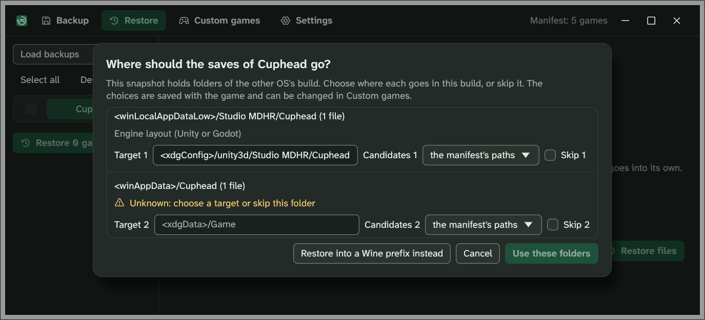

# Cross-OS restore

salvajocs can restore a backup made on one operating system onto another. This page explains the
two cases: the same Windows build of a game moved between Wine/Proton on Linux and native
Windows, and a native Linux build of a game moved to its Windows build or back. Back to the
[guide index](README.md).

## Why it works

salvajocs does not store the absolute paths of the machine that made the backup. It stores each
file under a named folder such as `WinDocuments`, `WinAppData` or `XdgConfig`, plus the path below
it. At restore time, each name is resolved on the machine you restore to. The Windows user name
is never stored, so `steamuser` in a Proton prefix and your Windows account name swap
automatically.

## Case 1: the Windows build, Wine/Proton and native Windows

This is the common case. A game runs on Windows and on Linux through Proton or Wine, and you want
the same save on both.

- **Linux to Windows.** Back up on Linux. The scan reads the save files from the Proton prefix and
  the registry keys from its `user.reg`. Restore on Windows: files go into your Windows folders,
  and the keys are written to `HKEY_CURRENT_USER`.
- **Windows to Linux.** Back up on Windows. Restore on Linux, choose **Windows build in a
  Wine/Proton prefix**, and make sure the prefix is right. The files go into the prefix's user
  folders and the keys into the prefix's `user.reg`.

No mapping is needed and no dialog appears. See the full walkthrough in the
[main README](../../README.md#restore-a-save-from-linux-on-windows).

Things to know:

- The prefix must exist. For a Steam game, start it once with Proton, so that
  `compatdata/<id>/pfx` exists. For other launchers, set the prefix on a
  [custom game](custom-games.md) or add it in [Settings](settings.md#wine-prefixes). salvajocs
  looks for the prefix the backup came from, then for one that holds the backup's save folders
  (see [Targets](restore.md#targets)).
- Close every Wine and Proton program before restoring registry keys into a prefix. See
  [Restore](restore.md#what-happens-when-you-click-restore-files).
- Only `HKEY_CURRENT_USER` keys are backed up and restored.
- A game's files that live in its install folder need the game to be found under a Steam library or
  a games folder you added in [Settings](settings.md#roots).
- Both machines must reach the same repository. Do not use `opendal:sftp` if one machine is
  Windows. Use an rclone remote of type `sftp` on Windows instead. See
  [Troubleshooting](troubleshooting.md#sftp-is-missing-on-windows).

## Case 2: a native Linux build and a Windows build

Some games have a native Linux build and a Windows build that keep their saves in different
places. salvajocs can map the folders of one onto the other. This is called a cross-build
restore. It happens when the backup holds folders the build you restore into does not have, for
example Linux folders restored on Windows.

The restore plan always shows a warning: the other build may use a different save format.
The safety backup lets you [undo it](restore.md#undo).

### How a folder is matched

For each folder of the backup, salvajocs looks for its destination in this order and uses the
first answer:

1. **Saved.** A pair or a skip you or an earlier restore saved for this game.
2. **Engine rule.** A built-in rule for these game engines:

   | Engine | Linux folder | Windows folder |
   | --- | --- | --- |
   | Unity | `<xdgConfig>/unity3d/{company}/{product}` | `<winLocalAppDataLow>/{company}/{product}` |
   | Godot | `<xdgData>/godot/app_userdata/{project}` | `<winAppData>/Godot/app_userdata/{project}` |

   Rules work for custom games too. Other engines have no rule.
3. **One of each.** If the manifest lists exactly one save folder for Linux and exactly one for
   Windows, and both end the same way after their last folder without wildcards, salvajocs
   pairs them.
4. **Unknown.** salvajocs asks you.

Folders matched by 1 to 3 are applied without a dialog. The plan shows where every file goes,
and you can still override a single file there.

The same matching lets the [Backup tab](backup.md#what-differs-from-the-last-backup) compare
your saves with a newest backup from the other build.

### The mapping dialog

The dialog is needed only when at least one folder is unknown. The plan then says how many
folders from the other build have no place here; click **Choose folders…** to open the dialog.
**Cancel** closes it, and the button stays. It lists every folder of the game:
the known ones are filled in and the unknown ones need your decision. Each row shows the folder,
its number of files and how its target was found.

For each row you can:

- type a **Target** (labelled Target 1, Target 2, ...);
- pick one from the **Candidates** list (Candidates 1, Candidates 2, ...), which holds the save
  paths the manifest knows for the build you restore into;
- tick **Skip** (Skip 1, Skip 2, ...) to leave that folder out.

A typed target must be a placeholder template, for example `<winLocalAppDataLow>/Company/Game` or
`<xdgData>/Game`, not a real path. Valid starts are `<home>`, `<xdgData>` and `<xdgConfig>` on
Linux, and `<home>`, `<winDocuments>`, `<winAppData>`, `<winLocalAppData>`,
`<winLocalAppDataLow>`, `<winPublic>`, `<winProgramData>` and `<winDir>` on Windows. A template
that is not valid shows an error in the row.

If you are on Linux and the backup holds Windows folders, **Restore into a Wine prefix instead**
switches the restore to a prefix.

Click **Use these folders**. The plan appears as usual.

When you [restore several games](restore.md#restore-several-games) at once, the dialogs come one
after another, one per game that needs it.

### Choices are remembered

After you confirm, salvajocs saves every row of the game: a target becomes a **pair**
(a Linux folder and a Windows folder for the same saves), and a skipped folder becomes a **skip**.
If the game is not a custom game yet, salvajocs adds one that extends the manifest entry. The
next restore of this game needs no dialog.

You can view, change and remove pairs and skips in the [Custom games](custom-games.md) tab. A skip
works in both directions: a skipped `<home>/Foo` is skipped on a Windows to Linux restore too.
Choosing a target for a skipped folder removes the skip.

### The Unity PlayerPrefs limit

Unity stores `PlayerPrefs` (usually game settings) in the registry on Windows, but in a file under
`~/.config/unity3d` on Linux. salvajocs does not convert between them. When it sees this, the
plan shows the note "Unity settings (PlayerPrefs) are stored differently and are not
converted". The files of the mapped folder are still restored.

## Safety

- A wrong pair writes files where the other build does not read them. Nothing is deleted, and the
  safety backup holds what was overwritten.
- A saved pair whose target is a whole folder, such as `<home>`, puts the mapped folder's files
  straight into that folder. The dialog and the plan say "The saved mapping … writes into the
  whole … folder"; check the plan, or change the pair in the Custom games tab.
- Same paths do not always mean the same file format. Check the game after a cross-build
  restore.
- Paths saved as plain absolute paths (a custom path on Linux, or a drive-letter path on Windows)
  only restore on the same kind of OS.

Back to [Restore](restore.md).
