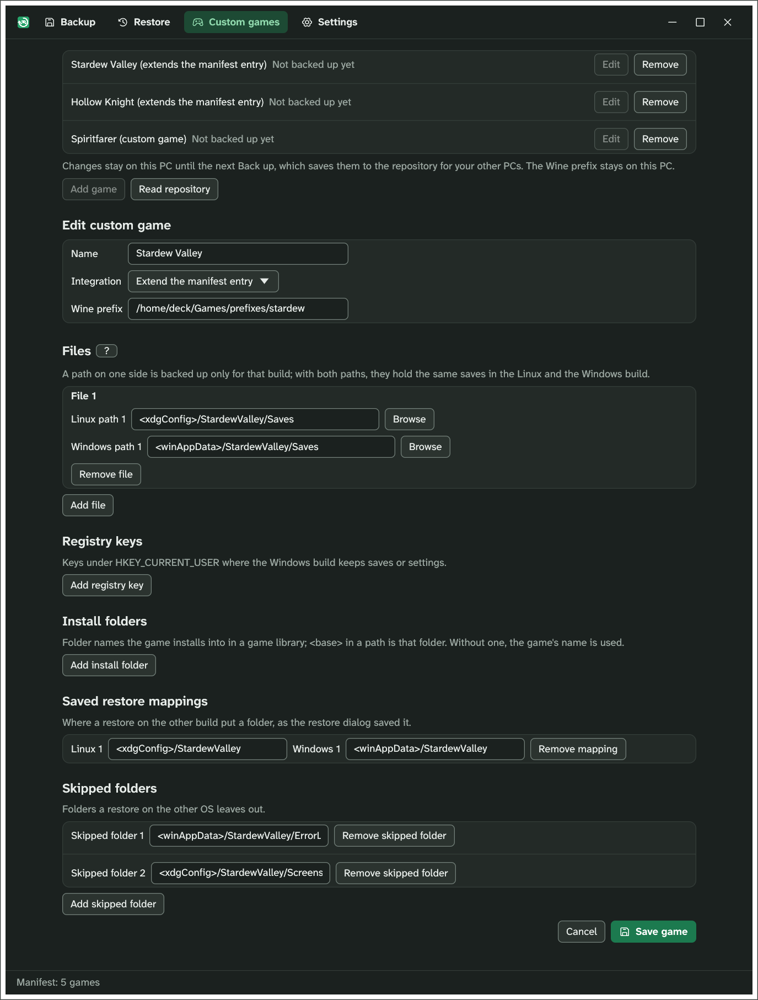

# Custom games

A custom game is a game you describe yourself: its save files, its registry keys and, if needed,
its Wine prefix. Use one when the manifest does not know a game, when it has a wrong path, or to
store the choices of a [cross-build restore](cross-os-restore.md). Back to the
[guide index](README.md).

The tab lists your custom games. Each line says how the game relates to the manifest: a custom
game, a game that extends the manifest entry, or one that overrides it. **Edit** and **Remove**
change the list. **Add game** opens the form. Changes are saved to the config at once.

## The form

| Field | What to enter |
| --- | --- |
| Name | The game's title. The name is how the game is matched with the manifest, so spell it exactly as the manifest does for an existing game. Two custom games cannot share a name. |
| Integration | **Extend the manifest entry** adds your files and keys to the manifest's. **Override the manifest entry** replaces the manifest's entry of the same title. For a title the manifest lacks, the two behave the same. |
| Files | One path template per line. |
| Registry keys | One `HKEY_CURRENT_USER/...` key per line. |
| Wine prefix | The Wine prefix of the game, for example a Heroic, Lutris or Bottles prefix. Leave it empty if the game does not need one. |

### Path templates

A path template starts with a named folder, then the path below it. Examples:

- `<winDocuments>/My Game/*.sav`
- `<winAppData>/My Game`
- `<xdgData>/my-game`
- `<home>/.mygame`
- `<base>/saves`, where `<base>` is the game's install folder
- `<root>/Saves`, where `<root>` is the Steam library or games folder holding the game

Wildcards such as `*` and `?` match as in a shell. A folder matches everything inside it. A relative path is
ignored, and `<storeUserId>` matches any value. Editing a line resets its OS condition. If a
game needs different paths per build, use a pair.

### Linux and Windows pairs

A pair tells salvajocs which Linux folder and which Windows folder hold the same saves, for
cross-build restores. A pair has a **Linux** side such as `<xdgData>/Game` and a **Windows** side
such as `<winAppData>/Game`. Both sides must be placeholder templates without wildcards. The
mapping dialog adds pairs here when you click **Use these folders**. You can edit or remove them.

### Skipped folders

A skipped folder is a template that a cross-build restore leaves out, for example
`<home>/Foo`. It applies in both directions. The mapping dialog adds skipped folders here when
you tick **Skip**.

## Saving

**Save game** checks the form. It reports an error for an empty or taken name, a pair or skip that
is not a placeholder template, and a game that changed while the form was open (use **Reload**).

## Using a Wine prefix from another launcher

salvajocs finds Steam's Proton prefixes by itself. It does not find the prefixes of Heroic, Lutris
or Bottles. For such a game, add a custom game with the same title as in the manifest, integration
**Extend**, and put the prefix path in **Wine prefix**. A game with its own prefix is looked up
there first.

Back to the [guide index](README.md).
