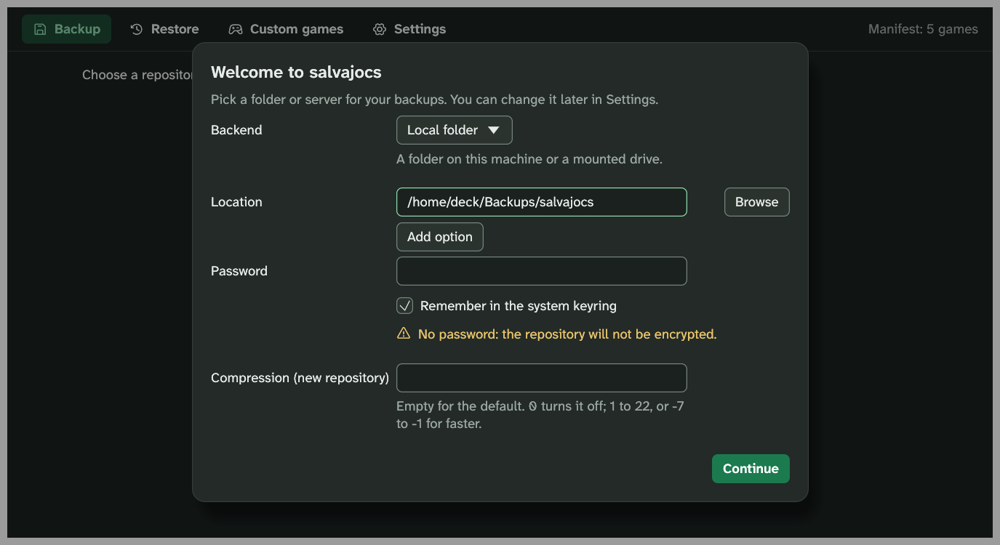

# First run

The first time salvajocs starts it asks where to store backups and whether to protect them with an
encryption password. If no repository exists there yet, it also asks how much to compress the
backups. This page explains each choice. Back to the
[guide index](README.md).

## The repository

A repository is the place where backups are stored. salvajocs writes it in the
[restic](https://restic.net) format through the embedded [rustic](https://rustic.cli.rs) library,
so you can also read it with restic ([details](restic-interop.md)).

The **Backend** list offers:

| Backend | Location field | Notes |
| --- | --- | --- |
| Local folder | A folder on this machine or a mounted drive. | The default. **Browse** opens a folder picker. |
| REST server | The URL of a rustic or restic REST server. | |
| rclone remote | `remote:path` | Needs the `rclone` program on your `PATH`. A **Remote** list shows the remotes from `rclone listremotes`; picking one fills the start of the location. |
| A service by name | None. Fill in the fields of the service. | Alibaba Cloud OSS, Amazon S3 (or compatible), Azure Blob Storage, Azure Data Lake Storage, Azure Files, Backblaze B2, Dropbox, FTP, Google Cloud Storage, Google Drive, Hadoop WebHDFS, Huawei Cloud OBS, IPFS (MFS), OneDrive, OpenStack Swift, pCloud, SFTP, Tencent Cloud COS, WebDAV and Yandex Disk. |

Each service shows its own fields, such as **Server URL**, **Bucket** or **Access key ID**.
Fields marked **Required.** must be filled before **Continue** is enabled. Secret fields such as
keys and tokens are masked, and their values are never written to the config file. With
**Remember passwords in the system keyring** ticked they go to the keyring. Otherwise salvajocs
asks for them each session.

**Advanced options** holds a free list of key and value pairs for settings that have no field,
such as a retry count. The **Option reference** link opens the
[advanced options reference](advanced-options.md) at the section of the backend, with the value
formats and the keys. A key the backend does not read gets a warning. Tick **secret** on an option
that holds a key or token. If a saved option has no field of its own, the list opens expanded.

If `rclone` is not installed, the rclone entry says so and you can still type the location.

`sftp` does not exist in Windows builds. If you use two machines and one runs Windows, pick another
backend. See [Troubleshooting](troubleshooting.md#sftp-is-missing-on-windows).

Four OpenDAL services are hidden because they do not make sense for backups: `memory` (data is
lost on exit), `http` (read only), `ghac` (works only in GitHub Actions) and `fs` (use Local
folder).

## Compression

Compression is a dropdown. It appears only when salvajocs finds no repository at the location and
asks whether to create one (see [Creating or opening](#creating-or-opening)).

| Entry | Meaning |
| --- | --- |
| Off | no compression |
| Fast (level 1) | zstd level 1 |
| Default (level 3) | zstd's default level |
| Smaller (level 9) | zstd level 9 |
| Smallest (level 19) | zstd level 19; slow, for the smallest backups |
| Custom level | a number field: `0` is off, `1` to `22` is a zstd level, `-7` to `-1` are zstd's fast levels |

A number outside those ranges is rejected. The level is stored in the repository, so every
machine that writes to it uses the same one. You set it when the repository is created. To change
it later, use [Settings](settings.md#compression). If the repository already exists, you are not
asked and the repository's own level is kept.

## Encryption password and keyring

The encryption password encrypts the repository. It is not the login of your server or storage
account. Three modes exist, and the dialog picks one from what you type:

| You do | Mode |
| --- | --- |
| Leave the encryption password empty | No password. Anyone who can reach the repository can read it. The dialog warns you. |
| Type an encryption password and tick **Remember passwords in the system keyring** | Stored in the keyring (Secret Service on Linux, Credential Manager on Windows). |
| Type an encryption password and untick it | Asked once each time you start the app. |

If the keyring is missing or refuses the value, salvajocs shows a warning and asks for the secret
each session instead. On Linux, without a Secret Service daemon it always asks. The Windows
Credential Manager rejects values longer than 2560 bytes, which also falls back to asking.

At each start salvajocs asks, in a **Repository secrets** dialog, only for the secrets it cannot
find in the keyring.

Keep the encryption password safe. Without it nobody can read the backups, including you.

## Creating or opening

Click **Continue**. salvajocs checks the location:

- **A repository exists and the password fits.** It opens it.
- **No repository exists.** The form is replaced by "There is no repository at ..." and "Do you
  want to create one?", with a note on whether it will be encrypted and the compression dropdown.
  **Back** returns to the form with your values. Nothing is created until you click **Create**, so
  a typo in the path does not make an empty repository. For a REST server or an rclone remote the
  dialog also warns that the server gives this answer when it refuses your login.
- **The password is wrong.** The dialog shows an error.
- **Anything else** (network, permissions, bad credentials) is shown as it is, and nothing is
  created.

Settings are written to `config.yaml` only after the repository opens.

## Using the same repository on a second machine

Run salvajocs on the other machine, choose the same backend and location, and type the same
password. The Restore tab then lists the backups from every machine. Pick a backend both machines
can reach.

## Next

[Back up your games](backup.md).
