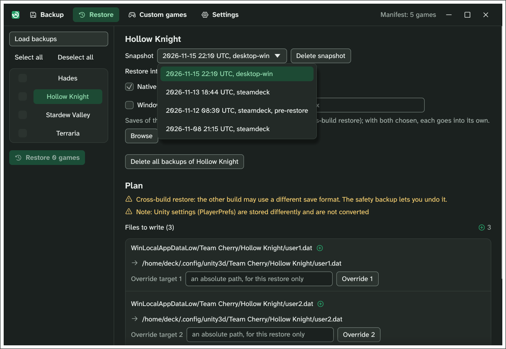
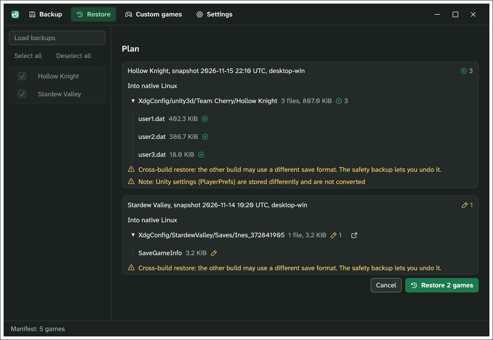

# Restore

The Restore tab lists the backups of every machine that uses the repository, shows exactly what a
restore would write, backs up what it is about to overwrite, and then writes the files. This page
walks through those steps and explains how to undo a restore. Back to the
[guide index](README.md).

## Steps

1. Click **Load backups**. The list shows every game in the repository, sorted by title. It
   includes backups made on other machines.
2. Click a game. The **Snapshot** list shows its backups, newest first, as `time, host`. A backup
   made by a restore adds `, pre-restore`. The newest backup that is not a `pre-restore` one is
   preselected.
3. Choose where to restore (see below).
4. Click **Preview**. Nothing is written yet.
5. Read the **Plan**. Fix anything you do not like (see "Overrides").
6. Click **Restore files**.

## Targets

On Windows, saves go into your own Windows folders. There is nothing to choose.

On Linux you choose the build you want to restore into:

- **Native Linux build**: the XDG folders of this machine.
- **Windows build in a Wine/Proton prefix**: a prefix path, such as `.../compatdata/<id>/pfx`.
  salvajocs fills it in with the game's own prefix: the `wine_prefix` set on a
  [custom game](custom-games.md), else a Proton prefix it can find (from its Steam id), else its
  Heroic or Lutris prefix ([Found by salvajocs](settings.md#found-by-salvajocs)). **Browse**
  opens a folder picker.

You can tick both. Each folder in the backup goes into the build it belongs to. Saves of the other
build are mapped onto the one you chose. See [Cross-OS restore](cross-os-restore.md).

The prefix must have a clear user. salvajocs uses the only user folder in `drive_c/users`
(`Public` and `root` do not count). With several, it uses `steamuser`. With several and no
`steamuser`, or with none, it shows an error. Run the game once to create the user folder. Inside
a prefix, folder names match without regard to case, so `My Games` and `my games` never end up
both existing.

## The preview

The Plan shows:

- **Files to write (N).** Each file shows `<Folder>/<path>` and, under it, the real path on this
  machine. A tag such as `(absolute path)` marks a path that was saved as a plain path.
- **Registry.** The number of registry keys and the prefix or the Windows registry they go into.
- **Skipped (N).** Items that will not be restored, each with its reason.
- A **Cross-build restore** warning when the plan maps folders from the other build. The
  other build may use a different save format.
- **Note** lines, for example about Unity settings. See
  [Cross-OS restore](cross-os-restore.md#the-unity-playerprefs-limit).

### Why an item is skipped

| Reason shown | Meaning |
| --- | --- |
| no target on this machine | There is no folder for it here and no mapping applies. |
| game not found under any root | The file lives in the game's install folder and salvajocs cannot find the game. Add the folder in [Settings](settings.md#roots). |
| skipped by choice | You skipped that folder in the mapping dialog. |
| path leaves its base directory | The path would escape its folder, so salvajocs refuses it. |
| outside the game's save roots | The file lies under none of the folders recorded in the backup. |
| save root not declared for this game | The file's folder is not one the game declares. salvajocs treats a snapshot as untrusted and restores only paths and registry keys the game is known to use. |
| registry: no Windows target | The backup has registry keys but you are restoring only into a native Linux build. |
| registry key not declared for this game | The key is not one the game declares. |

### Overrides

Each file line has an **Override target** field. Type an absolute path and click **Override** to
send that one file somewhere else, for this restore only. A path that does not fit is refused with
an error. If you typed a path and did not click **Override**, **Restore files** stays disabled and
the tab tells you to apply or clear it.

## What happens when you click Restore files

1. **Safety backup.** Before writing, salvajocs stores the files and registry keys the restore
   would replace, as a new snapshot of the same game tagged `pre-restore`, in the repository the
   backup came from. If this fails, nothing is restored. If nothing exists yet at the targets, no
   safety backup is needed, and the tab says so. If the repository already holds the same state,
   no new snapshot is added.
2. **Files.** Each file is written to a temporary file and moved into place. A target that is a
   symbolic link is never written through.
3. **Registry.** On Windows, the keys are written to the live registry under `HKEY_CURRENT_USER`.
   In a Wine prefix, salvajocs edits `user.reg` directly. For each key it replaces the whole
   subtree.

The result lists each file as restored or failed, and the registry result.

One thing blocks a restore: a restore that includes registry keys for a Wine prefix is refused
while any `wineserver` is running, because Wine would overwrite the change. Close every Wine and
Proton game and try again. Nothing is written in that case.

## Restore several games

To restore more than one game in one go:

1. Tick the checkbox before each game in the list, or click **Select all**. A game whose only
   backups are `pre-restore` ones cannot be ticked.
2. Click **Restore N games**. Each ticked game uses its newest backup that is not a `pre-restore`
   one, and the targets salvajocs fills in for it (see "Targets"). To choose another snapshot or
   target, or to override a file, restore that game on its own.
3. If a game's backup holds folders of the other OS's build that salvajocs cannot place, the
   mapping dialog opens for it, one game after another. See
   [Cross-OS restore](cross-os-restore.md). The choices you confirm are saved with the game, as in
   a single restore. The prefix option is not offered here. **Skip this game** leaves the game
   out and saves nothing. **Cancel** stops the whole batch, and nothing is restored; folder
   choices you already confirmed for earlier games stay saved.
4. Read the **Plan**. For each game it shows the snapshot, where the files go, each file that
   will fail, and the same warnings, registry and skipped items as the preview. Games that will
   not be restored are listed with the reason. Nothing is written yet. At the end of the
   snapshot's line, icons count the files that are new (a plus in a circle: nothing there yet),
   changed (a pencil: the file there differs) or unchanged (an equals sign). Counts of zero are
   left out; hover the icons to read the counts as text.

   Under it, a file tree lists every file the game writes, by the folder it goes into on this
   machine, as in the [Backup](backup.md) tab but without checkboxes. A file has an icon after
   its size: a plus in a circle when nothing is there yet, a pencil when the file there differs
   and will be overwritten, and a cross in a circle when salvajocs will not write it. Hover the
   icon to read `New: not on this PC yet`, `Changed: will be overwritten` or `Will fail` with the
   reason. An unchanged file has no icon; it is written all the same. The icons compare the
   contents, as they are when the plan is made. A folder's line counts the icons below it. A
   folder that already exists has a button that opens it in the file manager.
5. Click **Restore N games**.

Each game is restored as described above, with its own safety backup, and the next game goes on
whatever happens to it. A game whose restore is refused writes nothing: for example, when its
restore includes registry keys for a Wine prefix while a `wineserver` runs, or when its safety
backup fails. The **Plan** already lists a game whose safety backup cannot read a file at the
targets as one that will not be restored. The result shows `Restored N of M games`, then each
game's lines. A game that was not refused counts as restored even if some of its files failed;
those files are listed under it as failed.

## Undo

The safety backup is the undo. In the **Snapshot** list, choose the newest entry marked
`pre-restore` for that game, preview it, and restore it.

An undo has limits:

- It puts back what the restore overwrote. Files and registry keys the restore created are not in
  the old state, so they stay.
- A safety backup of a file that you redirected with **Override** is stored by its full path. Such
  files show up as skipped when you restore that snapshot through the normal flow.

## Deleting backups

To delete one backup, choose it in the **Snapshot** list and click **Delete snapshot**. To delete
every backup of the chosen game, click **Delete all backups of …**, which names the game. A
`pre-restore` backup can be deleted like any other.

A dialog names the game and lists the backups that go, as in the **Snapshot** list: `time, host`,
plus `, pre-restore` for a safety backup. Deleting removes them from the repository for every
computer that uses it, and cannot be undone. **Cancel** has the keyboard focus. Click **Delete**
to go ahead.

Deleting all backups of a game keeps your file choices for it (see
[Backup](backup.md#what-is-stored)). The buttons wait while the game manifest loads, the targets
are detected, or a preview or a restore runs. When the delete is done, the tab says how many
backups it removed and lists the games again. If it stops partway, the error says how many were
removed before it.

As with [old backups](settings.md#old-backups), the disk space comes back at a later cleanup, at
least a day later. In an append-only repository nothing is deleted, and the tab says so.

## Next

Restoring a Linux save on Windows, or the other way round: [Cross-OS restore](cross-os-restore.md).
