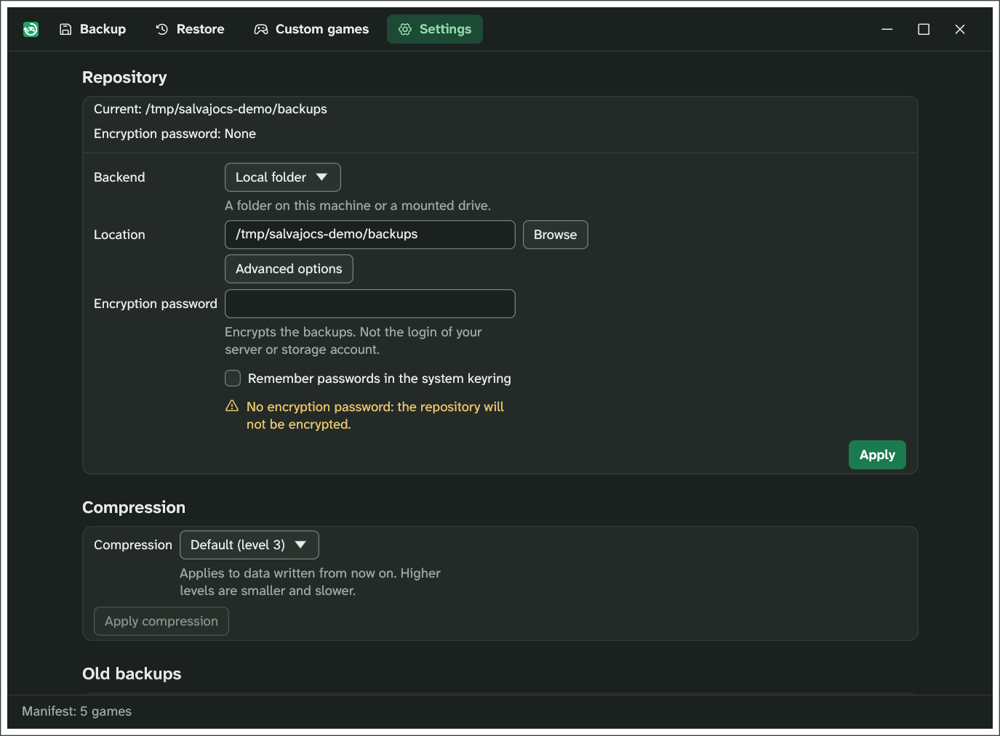

# Settings

The Settings tab changes the repository, the compression level, which old backups to keep, the
folders salvajocs looks in for games and the theme. This page covers each section. Back to the [guide index](README.md).

## Repository

The top of the tab shows the current repository and the encryption password mode (**None**,
**Stored in the system keyring** or **Asked once per session**). Below it is the same form as on
[first run](first-run.md): backend, location or service fields, advanced options, encryption
password and **Remember passwords in the system keyring**. The box is ticked when the encryption
password or a secret field, such as **Server password**, is in the keyring. Unticking it and
clicking **Apply** removes them from the keyring.

Click **Apply** to connect to a different repository. salvajocs checks it the same way as on
first run, and asks before it creates a new one, with the compression to use. The tabs then show
the new repository.

Keyring entries belong to one repository and its non-secret options. After you switch to another
repository, the tab offers **Delete entries** to remove the old ones, or **Keep entries**.

## Compression

The **Compression** dropdown shows the level of the open repository. Change it and click **Apply
compression**. The entries are the same as on [first run](first-run.md#compression). A level
without its own entry, such as 5, shows as **Custom level** with the number filled in.

The level is a property of the repository, so the change affects every machine that writes to it.

## Old backups

These rules decide which old backups of each game are removed. Tick one or both:

- **Keep the last [N] backups of each game**, from 1 to 9999.
- **Keep every backup newer than [N] days, weeks, months or years**, counted back from now.
  A month is 30 days and a year 365.

A backup is only made when a game's files changed, so the last N backups are the last N changes.
A backup is kept if any rule keeps it. The newest backup of each game, and of each computer, is
always kept. With both rules off, all backups are kept.

The same rules also remove the safety backups (`pre-restore`) a restore makes first. They are
counted on their own, so they never take the place of a game's regular backups.

Old backups are removed after the next backup. Their disk space comes back at a later cleanup, at
least a day later.

The rules are stored in the repository, so every machine that uses it shares them. The section is
disabled until the repository is open and its rules are loaded. Changes are saved at once; a typed
number is saved when you press Enter or leave the field. If the repository holds rules this
version cannot read, for example from a newer salvajocs, the section says so, stays disabled and
nothing is removed. If the repository could not be reached, click **Retry**. The rules are read
again each time you open the tab, so changes made on another computer show up.

## Roots

Roots tell salvajocs where games live on this machine. Add the ones you use. Each root has a
kind:

| Kind | Use it for | Effect |
| --- | --- | --- |
| Steam library | A Steam library folder, the one that holds `steamapps`. | Finds games in `steamapps/common/<install folder>` and Proton prefixes in `steamapps/compatdata`. |
| Games folder | A folder that holds game install folders. | Finds games in `<folder>/<install folder>`. |
| Wine prefix | A Wine prefix, for example `~/.wine`. | Every game is checked against the prefix. |

To add one, choose a **Kind**, type or **Browse** for the **Root folder**, and click **Add root**.
Click **Remove** to delete one. The changes are saved at once.

### Steam libraries

salvajocs finds the default Steam folders by itself: `~/.steam/steam`, `~/.local/share/Steam` and
the Flatpak Steam folder on Linux, and `Program Files (x86)\Steam` on Windows. A folder counts
only if it contains `steamapps`.

salvajocs does not read Steam's list of library folders. If your games are on another drive, add
that library as a **Steam library** root. If Steam lives somewhere salvajocs does not look, for
example because `$HOME` points elsewhere in a container, add its folder too.

### Wine prefixes

A **Wine prefix** root covers a prefix that does not belong to a Steam game, such as the default
`~/.wine`. It must contain `drive_c/users` and one of `system.reg`, `user.reg` or `dosdevices`.
On Linux, the prefixes of Heroic, Lutris and Bottles are found by themselves (see below).

When several prefixes match a game, they are checked in this order:

1. the game's own prefix: its Proton prefix, its custom `wine_prefix`, then its Heroic or
   Lutris prefix;
2. the Wine prefix roots, in the order you added them;
3. the Bottles prefixes, and the Heroic and Lutris prefixes that match no game.

### Found by salvajocs

On Linux, the **Found by salvajocs** list shows the Wine prefixes salvajocs found in the native
and Flatpak installs of Heroic, Lutris and Bottles. Each line has the prefix folder, the launcher
and, when salvajocs knows them, the games. Games that share a prefix share its line.

- A Heroic or Lutris prefix is matched to its game by its GOG, Steam or Lutris id, else by its
  title. It is checked for that game only.
- A Bottles prefix, or one whose game is unknown or matches several games, is checked for every
  game.
- Untick a prefix to leave it out of scans and restores, for example when it was matched to the
  wrong game. Tick it to use it again. The change is saved at once. A folder that is also a Wine
  prefix root or a custom game's prefix is still used as such.

Lutris games whose prefix is a relative path are not found. Add their prefix as a **Wine prefix**
root.

## Appearance

**Theme** is **System**, **Light** or **Dark**. **System** (the default) follows the light or dark
setting of your system; the other two always use that theme. The choice applies at once and is
saved in `config.yaml`.

## Updates

On Windows and in the AppImage, **Check for updates at start** (on by default) asks GitHub for a
newer release each time salvajocs starts. Untick it to stop the check. Other builds do not show
this setting.

## Where settings are stored

All settings except the compression level and the old-backup rules are in `config.yaml`, listed
in [Installation](installation.md#where-salvajocs-keeps-its-files). The compression level and the
old-backup rules are in the repository; passwords and secret options are in the keyring or asked
each session.
